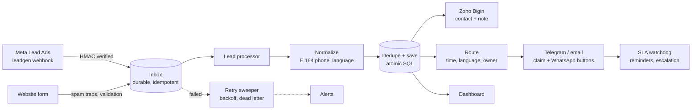

# LeadOps: unified admissions lead capture for n8n

One system for every admissions inquiry. Meta Lead Ads and website forms land in the same place, and duplicates are merged. Each inquiry is created in the CRM (Zoho Bigin) with its source, campaign and language. The right person is notified depending on time of day and language, is reminded if nobody picks it up, and the manager gets an escalation when the promised response time passes. A dashboard shows volume by channel and time to first response.

Built for a private school in the Gulf (about 320 inquiries a month, Arabic and English), on **n8n 2.41 + Postgres 17**, packaged with Docker.

## How it works



**The inbox comes first.** Every event is written to Postgres *before* Meta or the website gets a reply. If the database is down, Meta gets an error and retries by itself. If a later step fails (CRM down, Telegram down), the retry sweeper replays the event, and every step is idempotent. As a result a retry never creates a second contact, a second inquiry or a second alert.

## What's in the box

| Path | What it is |
|---|---|
| `n8n/workflows/` | 11 workflows (import with `setup.sh`) |
| `sql/01_schema.sql` | Tables and SQL functions: dedupe, routing, SLA, retries, dashboard |
| `sql/02_seed.sql` | Settings, team and routing rules. **Edit this for each school.** |
| `sql/03_demo_data.sql` | 95 days of realistic demo history (flagged, removable) |
| `web/inquiry-form.html` | Bilingual EN/AR form with UTM capture and spam traps |
| `tests/` | Signed Meta test lead, web lead, full acceptance suite |
| `docs/` | Setup guide, per-workflow docs, runbook, demo-video script |

| # | Workflow | Trigger |
|---|---|---|
| 01 | Meta Lead Ads intake | Webhook `GET/POST /webhook/leadops/meta` |
| 02 | Website form intake | Webhook `POST /webhook/leadops/web-form` |
| 03 | Lead processor | Sub-workflow |
| 04 | CRM sync (Zoho Bigin) | Sub-workflow |
| 05 | Notify agent | Sub-workflow |
| 06 | SLA watchdog | Every minute |
| 07 | Lead page (claim / contacted) | Webhook `GET/POST /webhook/leadops/lead` |
| 08 | Dashboard | Webhook `GET /webhook/leadops/dashboard` (basic auth) |
| 09 | Retry sweeper | Every 2 minutes |
| 10 | Alerts | Error Trigger + sub-workflow |
| 11 | Morning digest | 07:30 daily |

## Quick start

Requirements: a Linux VPS with Docker, and a domain pointing at it (Meta only sends webhooks to HTTPS).

```bash
cp .env.example .env        # fill in: URL, passwords, Meta, Bigin, Telegram
./setup.sh --demo           # --demo loads the sample history for the dashboard
tests/acceptance.sh         # 7 checks, prints PASS/FAIL with timings
```

Then follow `docs/SETUP.md` to connect Meta, Bigin and your team's Telegram accounts.

## Acceptance checks (tests/acceptance.sh)

1. Meta webhook verification returns `hub.challenge`.
2. A forged `X-Hub-Signature-256` is rejected with 401.
3. A signed Meta lead is in the CRM and the team is notified within 60 s, with the campaign attached.
4. The same Meta delivery sent twice creates one inquiry.
5. A website lead is in the CRM and notified within 60 s, with the campaign attached.
6. The same family inquiring again within 24 h is merged and does not trigger a second alert.
7. The dashboard answers behind its login.

In the reference test run (n8n 2.41.3, Postgres, mocked Meta/Bigin/Telegram), all 7 passed, and processing took about 1 second per lead.

## Engineering notes: things that broke while building this

These came up while building and testing. Each one is handled in the workflows.

- **Meta lead IDs are bigger than JavaScript can hold.** 17-digit ids lose their last digits in `JSON.parse`, and the Graph API then says the lead doesn't exist. The raw body is read and long ids are quoted before parsing.
- **The HMAC must be computed on the raw body.** Re-serialising the parsed JSON changes escaping, and every signature check fails. The raw body is hashed.
- **Campaign names need an extra permission.** Without `ads_read`, the Graph call that asks for `campaign_name` fails outright. The workflow retries with basic fields, so the lead is never lost.
- **Zoho uses `Authorization: Zoho-oauthtoken`, not Bearer.** It also returns HTTP 200 with `{"error":"invalid_code"}` when a refresh fails, and it limits how often a token can be refreshed. Tokens are therefore refreshed manually, validated and cached in Postgres.
- **Link scanners claimed leads.** Outlook Safe Links and chat previews open links automatically. Viewing a lead never claims it. Claiming is a button (POST), bots get 403, and Telegram link previews are off.
- **A sub-workflow whose last branch is empty returns nothing.** The caller then silently stopped before marking the lead notified. Calls use "always output data".
- **Postgres query parameters in n8n** can split values on commas and mishandle arrays. Values are passed as one array expression, and JSON is stringified explicitly.
- **n8n 2.x changes:** "Publish" replaces "Activate", sub-workflows must be published too, `$env` access must be enabled, `WEBHOOK_URL` became `N8N_WEBHOOK_URL`, and Postgres 16 only gets compatibility support.
- **Schedules every minute flood the executions table**, so successful watchdog and sweeper runs are not saved.
- **One incident, three alerts.** The error workflow fired for each nested sub-workflow. Only the top-level caller alerts now, and repeats within 15 minutes are suppressed.

**Known limitation.** If the database write fails in the instant after a notification was sent, the retry sends it again. This is at-least-once delivery, and a duplicate ping is preferable to a lost lead.

## Roadmap hooks (phases 2 and 3)

- **WhatsApp as a channel.** The inbox already accepts `source = 'whatsapp'`, and the dashboard already reserves the channel. A Cloud API webhook only needs an intake workflow and a mapper.
- **Real first contact.** The first outbound WhatsApp message can set `contacted_at` automatically instead of the staff button.
- **Conversions API.** `events` and `inquiries.campaign_id / fbclid` hold what is needed to send qualified-lead events back to Meta.
